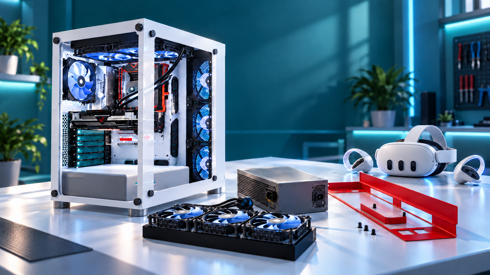
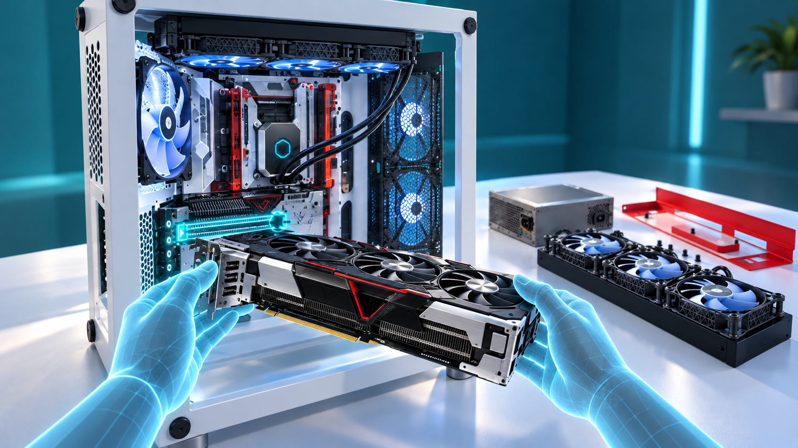
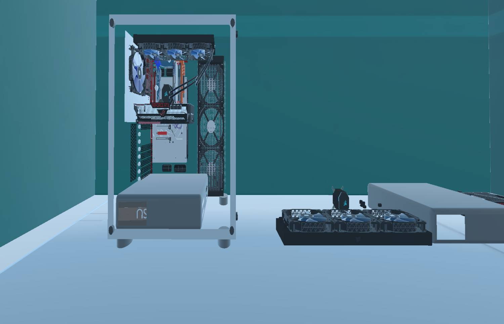
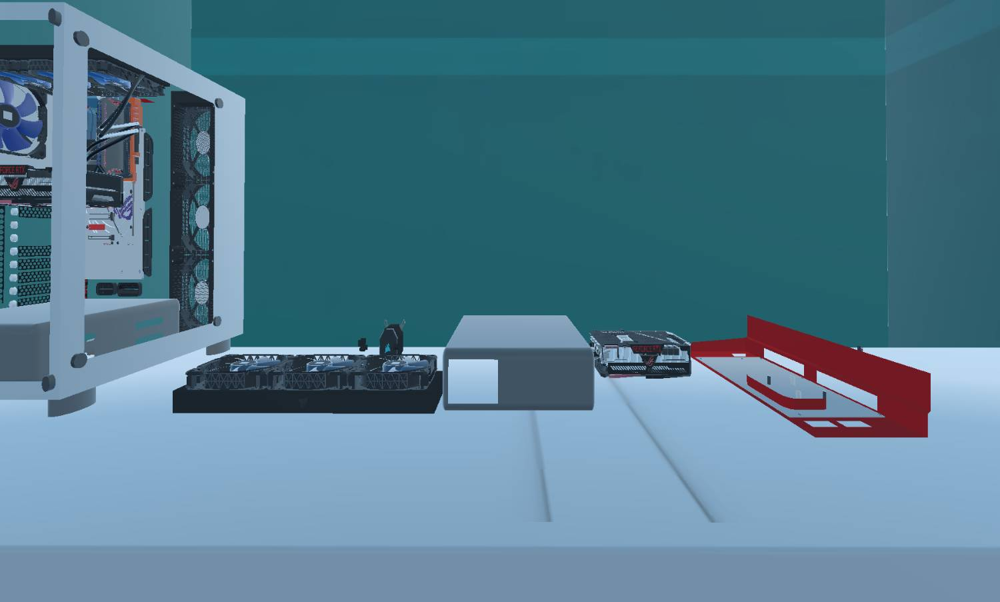
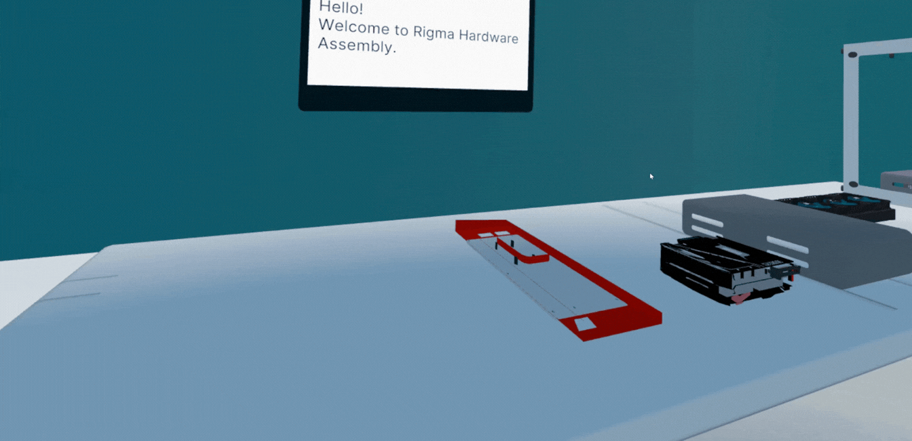
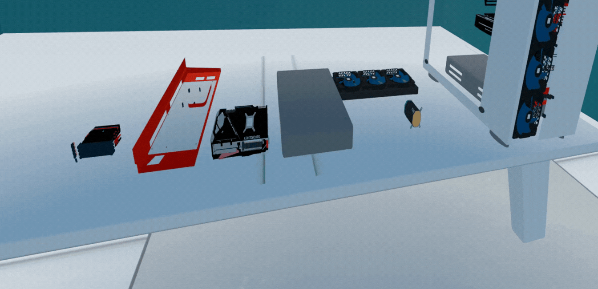
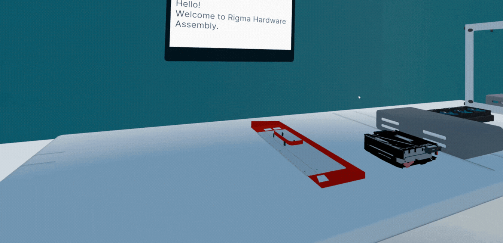

<a id="top"></a>

<p align="center">
  
</p>

<h1 align="center">RIGMA</h1>

<p align="center">
  <strong>شبیه‌ساز آموزشی مونتاژ و دمونتاژ کیس کامپیوتر در VR</strong>
  <br>
  <strong>Virtual Reality Training for PC Assembly &amp; Disassembly</strong>
</p>

<p align="center">
  <a href="#persian-version">فارسی</a>
  &nbsp;•&nbsp;
  <a href="#english-version">English</a>
  &nbsp;•&nbsp;
  <a href="mailto:Rigmaxr@gmail.com">Contact</a>
</p>

<p align="center">
  
  
  
  
  
</p>

---

<a id="persian-version"></a>

<div dir="rtl" align="right">

## نسخهٔ فارسی

### آموزش اسمبل و دیس‌اسمبل سخت‌افزار، این‌بار بدون ریسک آسیب به قطعات

**RIGMA** یک محیط آموزشی سه‌بعدی و تعاملی برای یادگیری عملی **مونتاژ و دمونتاژ کیس کامپیوتر** است. کاربر در یک کارگاه مجازی، قطعات مختلف را می‌شناسد، آن‌ها را با ترتیب صحیح جدا یا نصب می‌کند و برای انتخاب‌های نادرست بازخورد می‌گیرد.

هدف پروژه این است که فاصلهٔ میان آموزش نظری و تجربهٔ عملی را کمتر کند؛ بدون آن‌که در هر بار تمرین به کیس، قطعات واقعی، فضای کارگاه یا حضور دائمی مربی نیاز باشد.

> **چشم‌انداز RIGMA:** تبدیل آموزش مونتاژ سخت‌افزار به تجربه‌ای ایمن، تکرارپذیر، تعاملی و قابل ارزیابی در واقعیت مجازی.

### دسترسی سریع

- [معرفی پروژه](#fa-about)
- [مسئله و راهکار](#fa-problem)
- [تجربهٔ کاربر](#fa-experience)
- [قابلیت‌های کلیدی](#fa-features)
- [تصاویر و نمایش پروژه](#fa-gallery)
- [فناوری‌ها](#fa-stack)
- [نصب و اجرا](#fa-setup)
- [مسیر توسعه](#fa-roadmap)
- [تیم و راه ارتباطی](#fa-team)
- [English Version](#english-version)

<a id="fa-about"></a>

## 🚀 معرفی پروژه

در RIGMA، کاربر به‌جای تماشای صرف یک ویدئو یا کار با قطعات گران‌قیمت، مستقیماً وارد یک محیط سه‌بعدی می‌شود و فرایند باز و بسته‌کردن کیس را تمرین می‌کند.

| آنچه کاربر انجام می‌دهد | آنچه سامانه فراهم می‌کند |
|---:|---:|
| قطعات کیس را مشاهده و شناسایی می‌کند | نمایش سه‌بعدی قطعات در یک محیط آموزشی کنترل‌شده |
| قطعه یا ابزار موردنظر را انتخاب می‌کند | بررسی معتبر بودن انتخاب‌های کاربر |
| فرایند دمونتاژ را قدم‌به‌قدم پیش می‌برد | کنترل ترتیب و پیش‌نیازهای هر مرحله |
| قطعات را دوباره در محل صحیح نصب می‌کند | بازخورد دیداری برای انتخاب و عملکرد نادرست |
| مراحل را تکرار و خطاهای خود را اصلاح می‌کند | تجربه‌ای بدون آسیب به سخت‌افزار واقعی |

</div>

<p align="center">
  
</p>

<p dir="rtl" align="right"><sub>نمای مفهومی تجربهٔ نصب کارت گرافیک در محیط واقعیت مجازی</sub></p>

<div dir="rtl" align="right">

<a id="fa-problem"></a>

## 🎯 مسئله و راهکار

آموزش عملی سخت‌افزار معمولاً به تجهیزات واقعی، فضای کارگاهی و حضور مربی نیاز دارد. این وابستگی، تعداد دفعات تمرین را محدود می‌کند و یک انتخاب یا اتصال اشتباه می‌تواند باعث آسیب به قطعات شود.

| چالش آموزش سنتی | پاسخ RIGMA |
|---:|---:|
| احتمال آسیب به قطعات واقعی | تمرین در یک محیط شبیه‌سازی‌شده و ایمن |
| هزینهٔ تهیه و نگهداری تجهیزات | جایگزینی تجهیزات فیزیکی با قطعات سه‌بعدی ماندگار |
| فرصت محدود برای تمرین | تکرار آزادانهٔ هر سناریو بدون هیچ هزینه‌ای |
| وابستگی کامل به حضور مربی | راهنمایی گام‌به‌گام و بازخورد فوری، بدون نیاز به حضور مربی |
| ترس از اشتباه‌کردن | آزمون و خطای ایمن و فرصت برای تلاش، اصلاح و ادامه، بدون پیامد واقعی |

<a id="fa-experience"></a>

## 🧭 تجربهٔ کاربر

| ۰۱ · ورود | ۰۲ · شناخت | ۰۳ · دمونتاژ | ۰۴ · مونتاژ | ۰۵ · بازخورد |
|---:|---:|---:|---:|---:|
| ورود به کارگاه مجازی | بررسی کیس و قطعات | جداسازی با ترتیب صحیح | نصب دوبارهٔ قطعات | اصلاح خطا و تمرین |

منطق اصلی تجربه بر پایهٔ یک چرخهٔ ساده طراحی شده است:

1. کاربر قطعه یا ابزار موردنظر را انتخاب می‌کند.
2. سامانه درستی قطعه و ابزار انتخاب‌شده و رعایت توالی مراحل را کنترل می‌کند.
3. با انجام صحیح هر مرحله، پیشرفت کاربر ثبت می‌شود و مسیر آموزش ادامه می‌یابد.
4. در صورت انتخاب نادرست، سامانه با پیامی کوتاه و قابل‌فهم کاربر را متوجه خطا می‌کند و پس از اصلاح آن، مسیر به گام بعدی باز می‌شود.
5. کاربر انتخاب خود را اصلاح می‌کند، بی‌آن‌که پاسخ نهایی بلافاصله در اختیارش قرار بگیرد.

<a id="fa-features"></a>

## ✨ قابلیت‌های کلیدی

| قابلیت | شرح |
|---:|---:|
| 🧩 **آموزش مرحله‌به‌مرحله** | تبدیل یک فرایند پیچیده به گام‌های روشن و منظم |
| 🔐 **کنترل ترتیب عملیات** | جلوگیری از ادامهٔ مسیر تا زمان تکمیل پیش‌نیازهای هر مرحله |
| 🎯 **اعتبارسنجی تعامل** | تشخیص قطعه یا ابزار نادرست و کنترل تعامل‌های نامعتبر |
| 💡 **بازخورد دیداری** | نمایش پیام یا نشانه برای کمک به تشخیص و اصلاح خطا |
| 🧠 **یادگیری اکتشافی** | حفظ فرصت تصمیم‌گیری مستقل به‌جای نمایش فوری پاسخ |
| 🥽 **تعامل واقعیت مجازی** | گرفتن، جابه‌جایی و قرار دادن قطعات با دست یا کنترلر |
| 🔁 **تمرین تکرارپذیر** | اجرای چندبارهٔ سناریو بدون استهلاک سخت‌افزار واقعی |
| 🧱 **معماری قابل توسعه** | امکان افزودن قطعات، مراحل و سناریوهای آموزشی جدید |

<a id="fa-gallery"></a>

## 🖼️ تصاویر واقعی محیط پروژه

تصاویر زیر مستقیماً نمایی از محیط فعلی پروژه و چیدمان قطعات در صحنه را نشان می‌دهند.

</div>

<table dir="rtl">
  <tr>
    <td width="50%">
      <p align="center"></p>
      <p dir="rtl" align="right"><sub>نمای روبه‌رو و اجزای داخلی کیس</sub></p>
    </td>
    <td width="50%">
      <p align="center"></p>
      <p dir="rtl" align="right"><sub>نمای جانبی و چیدمان قطعات روی میز</sub></p>
    </td>
  </tr>
</table>

<div dir="rtl" align="right">

## 🎬 نمایش محیط و فرایند

</div>

<table dir="rtl">
  <tr>
    <td width="50%">
      <p align="center"></p>
      <p dir="rtl" align="right"><sub>ورود به محیط آموزشی</sub></p>
    </td>
    <td width="50%">
      <p align="center"></p>
      <p dir="rtl" align="right"><sub>بررسی قطعات و فضای تمرین</sub></p>
    </td>
  </tr>
</table>

<p align="center">
  
</p>

<p dir="rtl" align="right"><sub>مرور تصویری محیط، میز کار و قطعات شبیه‌ساز</sub></p>

<div dir="rtl" align="right">

<a id="fa-stack"></a>

## 🛠️ فناوری‌های استفاده‌شده

| فناوری | نقش در پروژه |
|---:|---:|
| **Unity** | توسعهٔ محیط سه‌بعدی، مدیریت صحنه و اجرای تعامل‌ها |
| **C#** | پیاده‌سازی منطق مراحل، وضعیت‌ها، اعتبارسنجی و بازخورد |
| **Blender / 3ds Max** | مدل‌سازی، متریال‌گذاری و آماده‌سازی دارایی‌های سه‌بعدی |
| **Meta Quest 3** | هدست هدف برای تجربه و ارزیابی تعامل واقعیت مجازی |
| **Git & GitHub** | کنترل نسخه، همکاری تیمی و مستندسازی پروژه |

## 📁 ساختار اصلی پروژه

</div>

```text
VR-Hardware-Assembly/
├── Assets/             # Scenes, scripts, models, materials, UI
├── Packages/           # Unity package dependencies
├── ProjectSettings/    # Unity and XR project settings
├── README-assets/      # Images and GIFs displayed in README
├── README.md           # Persian + English documentation
└── ...
```

<div dir="rtl" align="right">

<a id="fa-setup"></a>

## 🚀 نصب و اجرا

### پیش‌نیازها

- نصب **Git** و **Unity Hub**
- نصب نسخهٔ Unity Editor ثبت‌شده در فایل `ProjectSettings/ProjectVersion.txt`
- یک سیستم مناسب برای اجرای محیط سه‌بعدی
- **Meta Quest 3** و کابل Link یا اتصال بی‌سیم مناسب برای آزمایش نسخهٔ VR
- ماژول‌های ساخت موردنیاز Unity، متناسب با سکوی خروجی پروژه

### ۱) دریافت پروژه

</div>

```bash
git clone https://github.com/RigmaXR/VR-Hardware-Assembly.git
cd VR-Hardware-Assembly
```

<div dir="rtl" align="right">

اگر مخزن از **Git LFS** استفاده می‌کند، پس از نصب Git LFS این دو دستور را نیز اجرا کنید:

</div>

```bash
git lfs install
git lfs pull
```

<div dir="rtl" align="right">

### ۲) بازکردن پروژه در Unity

1. برنامهٔ **Unity Hub** را اجرا کنید.
2. گزینهٔ **Add project from disk** را بزنید.
3. پوشهٔ `VR-Hardware-Assembly` را انتخاب کنید.
4. پروژه را با همان نسخه‌ای باز کنید که در `ProjectSettings/ProjectVersion.txt` ثبت شده است.
5. تا پایان Import شدن Assetها و Packageها صبر کنید.
6. صحنهٔ اصلی پروژه را از پوشهٔ صحنه‌ها در `Assets` باز کنید.

### ۳) اجرای نسخهٔ VR

1. هدست Meta Quest 3 را متصل و شناسایی کنید.
2. تنظیمات XR و Build Target را با پیکربندی فعلی پروژه تطبیق دهید.
3. برای آزمایش سریع در Editor، دکمهٔ **Play** را بزنید.
4. برای اجرای مستقل، خروجی متناسب با سکوی هدف را Build و روی هدست نصب کنید.

> نسخهٔ Unity، صحنهٔ آغازین و روش اجرای هدست باید همیشه با تنظیمات داخل خود پروژه هماهنگ باشند.

<a id="fa-roadmap"></a>

## 🗺️ مسیر توسعه

- تعریف مسئله، سناریوی آموزشی و دامنهٔ اولیه
- طراحی محیط سه‌بعدی و آماده‌سازی مدل قطعات اصلی
- ساخت نمونهٔ اولیهٔ محیط و چیدمان قطعات
- تکمیل منطق مونتاژ و دمونتاژ مرحله‌ای
- تکمیل بازخورد خطا و راهنمای درون محیط
- ارزیابی تجربهٔ کاربری با Meta Quest 3
- بهینه‌سازی عملکرد، رفع خطاها و آماده‌سازی نسخهٔ نمایشی
- مستندسازی نهایی و توسعهٔ سناریوهای آموزشی بیشتر

<a id="fa-team"></a>

## 👥 تیم پروژه

**تیم Rima — توسعه‌دهندهٔ RIGMA**

| نقش | نام | معرفی |
|---:|---:|---:|
| ایده‌پرداز و سرگروه | **پریا کاظمی‌نژاد** | دانشجوی محیط‌زیست، دانشگاه صنعتی اصفهان |
| توسعه‌دهندهٔ پروژه | **عاطفه جوزی** | دانشجوی مهندسی کامپیوتر، دانشگاه صنعتی اصفهان |

## 📬 ارتباط با ما

برای گفت‌وگو دربارهٔ پروژه، همکاری یا دریافت اطلاعات بیشتر:

</div>

<p align="center">
  <a href="mailto:Rigmaxr@gmail.com"><strong>Rigmaxr@gmail.com</strong></a>
  <br>
  <a href="https://github.com/RigmaXR"><strong>github.com/RigmaXR</strong></a>
</p>

<p align="center">
  <strong>RIGMA · تمرین عملی سخت‌افزار در واقعیت مجازی</strong>
  <br>
  <sub>ساخته‌شده با دقت و علاقه توسط تیم Rima</sub>
  <br><br>
  <a href="#top">↑ بازگشت به بالای صفحه</a>
</p>

---

<a id="english-version"></a>

## English Version

### Learn hardware assembly and disassembly—without risking damage to components

**RIGMA** is an interactive 3D learning environment for practicing **PC assembly and disassembly**. Inside a virtual workshop, learners identify components, remove and reinstall them in the correct sequence, and receive feedback when an interaction is invalid.

The project is designed to bridge the gap between theoretical instruction and hands-on experience without requiring a PC, real components, workshop space, or the continuous presence of an instructor for every practice session.

> **RIGMA's vision:** Make practical hardware training safe, repeatable, interactive, and assessable through virtual reality.

### Quick Navigation

- [Project Overview](#en-about)
- [Problem & Solution](#en-problem)
- [Learning Experience](#en-experience)
- [Key Features](#en-features)
- [Project Media](#en-gallery)
- [Technology Stack](#en-stack)
- [Installation](#en-setup)
- [Roadmap](#en-roadmap)
- [Team & Contact](#en-team)
- [نسخهٔ فارسی](#persian-version)

<a id="en-about"></a>

## 🚀 Project Overview

Instead of only watching tutorials or working with costly physical components, RIGMA places the user inside a 3D workspace where the complete PC assembly and disassembly process can be practiced directly.

| What the learner does | What RIGMA provides |
|:---|:---|
| Observes and identifies PC components | 3D components inside a controlled learning environment |
| Selects a component or tool | Validation of the user's selections |
| Performs disassembly step by step | Sequence and prerequisite control |
| Reinstalls components in the correct location | Visual feedback for incorrect selections or actions |
| Repeats the stages and corrects mistakes | An experience without damaging real hardware |

<p align="center">
  
  <br>
  <sub>Concept artwork illustrating graphics-card installation in virtual reality</sub>
</p>

<a id="en-problem"></a>

## 🎯 Problem & Solution

Traditional hardware training relies on physical equipment, workshop space, and instructor availability. These requirements limit practice opportunities, while an incorrect removal or installation step can damage real components.

| Traditional training challenge | RIGMA's response |
|:---|:---|
| Risk of damaging real components | Practice inside a controlled simulation |
| Cost of acquiring and maintaining equipment | Replace physical equipment with durable, reusable 3D components |
| Limited opportunities for repetition | Freely repeat each scenario at no additional cost |
| Dependence on continuous instructor presence | Step-by-step guidance and immediate feedback without requiring an instructor |
| Fear of making mistakes | Safe trial and error with opportunities to try, correct, and continue without real-world consequences |

<a id="en-experience"></a>

## 🧭 Learning Experience

| 01 · Enter | 02 · Identify | 03 · Disassemble | 04 · Assemble | 05 · Improve |
|:---:|:---:|:---:|:---:|:---:|
| Enter the virtual workshop | Inspect the case and components | Remove parts in sequence | Reinstall each component | Correct mistakes and keep practicing |

The core experience follows a clear learning loop:

1. The learner selects a component or tool.
2. RIGMA verifies the selected component or tool and checks whether the correct sequence has been followed.
3. When a stage is completed correctly, the user's progress is recorded and the training continues.
4. If a selection is incorrect, RIGMA displays a short, clear message; once the mistake is corrected, the next step becomes available.
5. The user revises the choice without being given the final answer immediately.

<a id="en-features"></a>

## ✨ Key Features

| Feature | Description |
|:---|:---|
| 🧩 **Step-by-step training** | Break a complex procedure into clear, orderly stages |
| 🔐 **Sequence control** | Prevent progression until stage prerequisites are completed |
| 🎯 **Interaction validation** | Detect incorrect components, tools, or invalid actions |
| 💡 **Visual feedback** | Help learners recognize and correct mistakes |
| 🧠 **Exploratory learning** | Preserve independent decision-making instead of revealing answers immediately |
| 🥽 **Virtual-reality interaction** | Grab, move, and position components using hands or controllers |
| 🔁 **Repeatable practice** | Repeat scenarios without wearing out physical components |
| 🧱 **Extensible design** | Add new parts, stages, and training scenarios over time |

<a id="en-gallery"></a>

## 🖼️ In-Project Captures

The images below show the current project environment and component layout inside the scene.

<table>
  <tr>
    <td width="50%" align="center">
      
      <br><sub>Front view and internal PC components</sub>
    </td>
    <td width="50%" align="center">
      
      <br><sub>Side view and workbench component layout</sub>
    </td>
  </tr>
</table>

## 🎬 Environment & Workflow Preview

<table>
  <tr>
    <td width="50%" align="center">
      
      <br><sub>Entering the learning environment</sub>
    </td>
    <td width="50%" align="center">
      
      <br><sub>Inspecting components and the practice space</sub>
    </td>
  </tr>
</table>

<p align="center">
  
  <br>
  <sub>Visual loop of the simulator environment, workbench, and components</sub>
</p>

<a id="en-stack"></a>

## 🛠️ Technology Stack

| Technology | Role |
|:---|:---|
| **Unity** | 3D environment, scene management, and interactive behavior |
| **C#** | Stage logic, state management, validation, and feedback |
| **Blender / 3ds Max** | 3D modeling, materials, and asset preparation |
| **Meta Quest 3** | Target headset for VR interaction and experience testing |
| **Git & GitHub** | Version control, collaboration, and project documentation |

## 📁 Project Structure

```text
VR-Hardware-Assembly/
├── Assets/             # Scenes, scripts, models, materials, UI
├── Packages/           # Unity package dependencies
├── ProjectSettings/    # Unity and XR project settings
├── README-assets/      # Images and GIFs displayed in README
├── README.md           # Persian + English documentation
└── ...
```

<a id="en-setup"></a>

## 🚀 Installation & Setup

### Prerequisites

- **Git** and **Unity Hub**
- The Unity Editor version recorded in `ProjectSettings/ProjectVersion.txt`
- A computer capable of running the 3D environment
- **Meta Quest 3** with a suitable Link cable or wireless connection for VR testing
- The Unity build modules required by the project's configured target platform

### 1) Clone the repository

```bash
git clone https://github.com/RigmaXR/VR-Hardware-Assembly.git
cd VR-Hardware-Assembly
```

If the repository uses **Git LFS**, install it and retrieve the tracked assets:

```bash
git lfs install
git lfs pull
```

### 2) Open the Unity project

1. Launch **Unity Hub**.
2. Select **Add project from disk**.
3. Choose the `VR-Hardware-Assembly` directory.
4. Open it with the Editor version recorded in `ProjectSettings/ProjectVersion.txt`.
5. Wait for Unity to finish importing assets and packages.
6. Open the project's main scene from its scenes directory under `Assets`.

### 3) Run the VR experience

1. Connect and verify the Meta Quest 3 headset.
2. Match the XR settings and Build Target to the project's current configuration.
3. Press **Play** for a quick Editor test.
4. For standalone use, build the appropriate target and install it on the headset.

> The Unity version, startup scene, and headset workflow should always match the settings stored in the project.

<a id="en-roadmap"></a>

## 🗺️ Roadmap

- Define the initial problem, learning scenario, and project scope
- Design the 3D environment and prepare the main component models
- Build the initial environment and component layout
- Complete the stage-based assembly and disassembly logic
- Complete in-app guidance and error feedback
- Evaluate the user experience with Meta Quest 3
- Optimize performance, fix issues, and prepare the demo build
- Finalize documentation and expand the training scenarios

<a id="en-team"></a>

## 👥 Project Team

**Team Rima — the team behind RIGMA**

| Role | Name | Background |
|:---|:---|:---|
| Project originator and team lead | **Parya Kazemi-Nejad** (پریا کاظمی‌نژاد) | Environmental Science student, Isfahan University of Technology |
| Project developer | **Atefeh Jouzi** (عاطفه جوزی) | Computer Engineering student, Isfahan University of Technology |

## 📬 Contact

For collaboration, questions, or more information:

<p align="center">
  <a href="mailto:Rigmaxr@gmail.com"><strong>Rigmaxr@gmail.com</strong></a>
  <br>
  <a href="https://github.com/RigmaXR"><strong>github.com/RigmaXR</strong></a>
</p>

---

<p align="center">
  <strong>RIGMA · Practical Hardware Training in Virtual Reality</strong>
  <br>
  <sub>Built with care by Team Rima</sub>
  <br><br>
  <a href="#top">↑ Back to the top</a>
</p>
